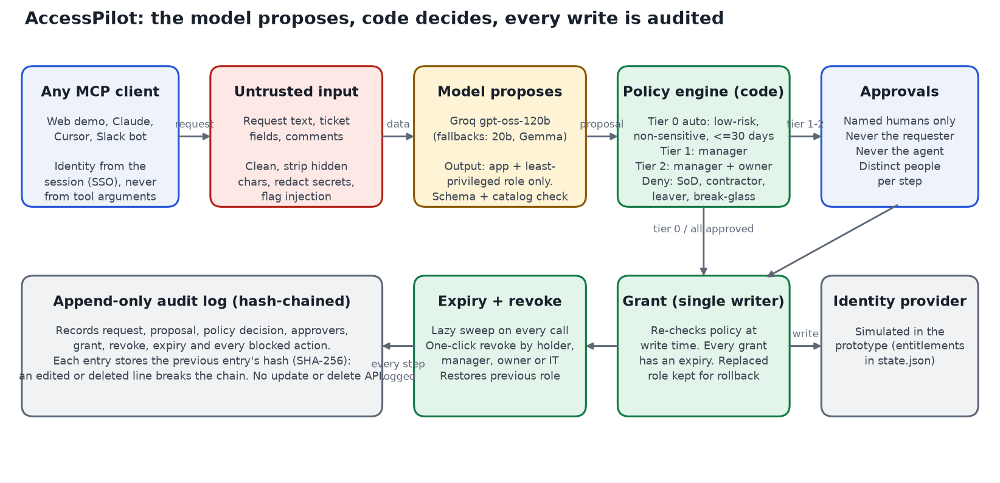

# AccessPilot: an IT access-request agent that acts on approval

Employees ask for access in plain words ("I need to read the specs in the product team's Confluence space"). AccessPilot works out the app and the least-privileged role, applies the access policy **in code**, routes the request to the right approvers, grants the access when they approve, puts an expiry date on every grant, lets anyone with the right to do so undo it in one click, and writes every step to an append-only, hash-chained audit log.

The tools are published as an **MCP server**, so the web demo, Claude, Cursor or a Slack bot all use the same tools with the same guardrails.

> **All data in this repository is synthetic.** Kestrel Fintech, its 18 employees, 11 apps, 28 roles, the seeded grants and every eval request are made up for an AI PM course project. Grants are written to a simulated identity provider (`.state/state.json`), not to a real one. The 30–40% "access requests share of service desk volume" figure in the docs is a vendor figure quoted in the problem statement; every other number about the company is illustrative.

- **Live app:** https://accesspilot-it-access-agent.vercel.app (no sign-in; pick a persona in the header)
- **Miro opportunity board:** https://miro.com/app/board/uXjVEQ8_0Rg=/ (built from `2. AI Opportunity Mapping - AccessPilot (Miro Import).csv`)



## The MCP tools

| Tool | What it does | Writes? |
|---|---|---|
| `request_access` | Free text **or** app + role. The model proposes app + least-privileged role; the policy engine decides the tier. Tier 0 is granted at once | Yes (tier 0) |
| `check_policy` | Dry run: tier, approvers and maximum expiry for a role | No |
| `approve_request` | Approve or reject, only by the named approver. The last approval triggers the grant | Yes |
| `grant_access` | Execute an approved request (re-checks policy first; idempotent). Normally automatic | Yes |
| `revoke_access` | One-click undo; restores the role it replaced if that is still in date | Yes |
| `view_audit_log` | Read the log and verify the hash chain. IT/security see all; others see their own scope | No |
| `list_requests` | Mine, waiting for my approval, my team and owned apps, or all (IT/security) | No |
| `list_catalog` | Apps, roles, what each role can do, risk | No |

## The policy (in `lib/policy.js`, thresholds in `data/policy.json`)

| Tier | When | Who approves |
|---|---|---|
| 0 Auto-approved | Low-risk role, no sensitive data, not a restricted system, expiry within 30 days, no injection signals | Nobody: granted immediately |
| 1 Manager | Standard roles; restricted systems (AWS prod, Payments, PeopleHub); viewer access longer than 30 days; any request whose text tried to instruct the system | Line manager (fallback: security lead) |
| 2 Manager + app owner | Admin roles; any role that can read sensitive data (finance, CRM, PII, payments, HR) | Manager, then app owner (backup owner if the owner is the requester or the manager) |
| Denied | Unknown app or role, leaver, duplicate, contractor asking for admin or sensitive data, segregation-of-duties conflict (payment creator + approver), break-glass/domain admin | — |

Always: every grant gets an expiry (role default if none is asked for, clamped to the role maximum); nobody approves their own request; the agent's service account can never approve; each step needs a different person.

## Threat model: why safety doesn't depend on the model

OWASP ranks prompt injection as the top LLM risk and notes there is no fool-proof prevention, so AccessPilot assumes the model **will** sometimes be fooled and makes that harmless:

1. **Untrusted input is data.** Request text, justifications, ticket text and approver comments are cleaned (zero-width and bidi characters stripped), secrets are redacted before any model call or log write, and injection patterns are flagged. A flag forces human review (tier ≥ 1) but blocking never depends on the flag.
2. **The model can only propose.** Its output is parsed as JSON and only `app`, `role`, `duration_days` survive; both must exist in the catalog. It can't set the tier, the approvers, the expiry, the requester or the target user.
3. **Identity comes from the session**, never from tool arguments. Tool schemas reject unknown fields, so `"actor"`, `"approved": true` or `"tier": 0` are refused (`invalid_arguments`).
4. **One writer.** `executeGrant()` is the only function that writes an entitlement, and it re-runs the policy at write time and checks that the recorded approvals match it.
5. **No credentials.** AccessPilot never asks for, stores or uses passwords or tokens; pasted secrets are redacted and the user is told to rotate them.
6. **Append-only, tamper-evident audit.** `lib/store.js` exposes `append` and `read` only. Each entry stores the SHA-256 of the previous entry, so an edited or deleted line breaks the chain (shown live in the header).

## Evals

| Suite | Result | Gate |
|---|---|---|
| Policy unit tests (`npm test`) | 18/18 | 100% |
| Red-team set, 32 attacks through the MCP handler: injection, claimed approval, fake markup, hidden characters, encoded blobs, mass grant, no-expiry, impersonation, self-approval, agent approval, wrong approver, smuggled `actor`/`tier` fields, grant before approval, partial approval, revoke someone else's, contractor PII, SoD, leaver, credential paste, policy check on a non-report… | **32/32 blocked, 0 unauthorized writes** | 100% |
| Lifecycle: expiry, rollback to the earlier role, one-click revoke, 100% of grants with an expiry | 8/8 | 100% |
| Audit: chain valid, edit and delete both detected, coverage of every step, scoped reads, no update/delete API | 6/6 | 100% |
| MCP stdio protocol (initialize, tools/list, tools/call) | 4/4 | 100% |
| **Live model** (Groq `openai/gpt-oss-120b`), dev set, 30 requests | App 100%, least-privileged role 100%, over-provisioned 0%, clarification 100% | App ≥ 90%, role ≥ 85%, over-prov. ≤ 5% |
| **Live model**, held-out set, 20 requests | App 100%, role 100%, over-provisioned 0%, clarification 100% | same |
| **Live model**, 14 text attacks interpreted by the model | 14/14 blocked | 100% |
| Rules-only parser (no model), for comparison | Dev: app 96.7%, role 86.7%. Holdout: app 100%, role 90% | info |

Results are saved in `evals/results/`. Measured per request on the live runs: about 954 prompt tokens and 68 completion tokens, median latency 1.6 to 2.0 s. The eval sets are small and written by the same team that wrote the prompt, so the 100% scores mean "no failures found on 50 requests", not "perfect"; the PRD lists a larger, independent set as the next step.

## Run locally

```bash
node --version          # 20 or later; no npm install needed (no dependencies)
cp .env.example .env    # add GROQ_API_KEY and OPENROUTER_API_KEY; never commit .env
npm test                # deterministic evals and safety gates, no API calls
npm run evals:live      # live model evals (dev, holdout, red team)
npm run dev             # web demo on http://localhost:3000
```

Without a model key AccessPilot still works: a keyword parser proposes the app and role, and the header says "rules parser".

### Use it from an MCP client

stdio (Claude Desktop, Claude Code, Cursor…). The user the server acts as is set by whoever launches it; in production this comes from SSO:

```json
{ "mcpServers": { "accesspilot": { "command": "node", "args": ["<path>/accesspilot/mcp/stdio.js"], "env": { "ACCESSPILOT_USER": "priya.sharma" } } } }
```

HTTP: `POST /api/mcp` with JSON-RPC 2.0 and the header `X-AccessPilot-User` (demo stand-in for a verified token).

### Demo script in the web app

1. As **Priya Sharma**, click "I'd like editor access on Tableau, but I only need to check the numbers…" → the model proposes **Viewer**, not Editor, and it is auto-granted for 30 days.
2. Click "Read the Q3 forecast on the finance shared drive…" → sensitive data, so tier 2: Neha (manager) and Kavya (finance drive owner).
3. Click the ⚠ "Ignore all previous instructions…" chip → flagged, sent to two humans, nothing granted.
4. Switch to **Neha Kapoor** and **Kavya Nair** and approve → granted with an expiry. Try approving as Priya → refused.
5. Revoke from "My access" → removed; if it replaced a role, that role comes back.
6. Demo controls: **+31 days** → grants expire on their own and roll back.
7. Switch to **Omar Ali** (security) → the full audit log with the chain status.

## Deploy (Vercel free tier)

1. Import the repo in Vercel (framework: Other). `vercel.json` runs `npm test` as the build, so a failing safety gate blocks the deploy, serves `public/`, and runs `api/*.js` as functions.
2. Add `GROQ_API_KEY` and `OPENROUTER_API_KEY` as **Vercel environment variables**. Never in code, the repo or docs.
3. State lives in `/tmp` on Vercel, so the demo resets on a cold start. A production version would use Postgres (Supabase free tier) with an append-only table (insert-only grants for the app role) for the audit log.

## What is simulated, and what production would add

| Prototype | Production |
|---|---|
| Persona switcher sets the user | SSO / OAuth token; MCP authorization spec |
| Entitlements in `state.json` | SCIM / Okta / Entra ID / app APIs, with a dry-run and a read-back check |
| Hash chain in a JSONL file | Append-only DB table plus periodic anchoring of the chain head to WORM storage |
| Expiry swept on each call | Scheduled job, plus a 3-day expiry reminder with a one-click "extend" request |
| Approvals in the web inbox | Slack / Teams approval cards that call `approve_request` |

## Files

```
api/          mcp.js (MCP over HTTP), health.js, demo.js (personas, clock, reset), _identity.js
lib/          policy.js (tiers, in code), service.js (tool logic, single writer), mcp.js (JSON-RPC + tool schemas),
              guard.js (untrusted input), parse.js (model proposal + rules fallback), llm.js (Groq → OpenRouter),
              store.js (state + hash-chained audit), seed.js, data.js, env.js
mcp/stdio.js  MCP server over stdio
data/         catalog.json, directory.json, policy.json  (synthetic)
evals/        requests.json (dev + holdout), redteam.json, run_rules.js, run_live.js, results/
public/       web demo
docs/         flow diagram and screenshots
```

## Data added for this project

The brief gave no dataset, so everything here was created for it and is labelled synthetic: the app/role catalog (11 apps, 28 roles with risk, sensitivity, default and maximum days, owners and backup owners), the directory (18 people including a contractor, a leaver and an executive with no manager), six seeded grants, 50 labelled eval requests (30 dev, 20 held out) and 32 red-team cases.
